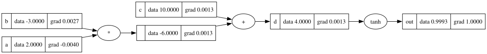

# micrograd

A scalar-valued reverse-mode autodiff engine, reimplemented from scratch and annotated line by
line — from the definition of a derivative to a multi-layer perceptron that trains.

This follows Andrej Karpathy's [micrograd](https://github.com/karpathy/micrograd), reimplemented
rather than forked. What it adds is the written explanation: the notebook is a course, not a
transcript, and the engine's comments say why each `_backward` is what it is. The engine is also
ported to Rust, in `micrograd-rs/`, callable from Python and checked against the Python one.



## Read it

`notebook.ipynb` is the course, in order:

1. a refresher on derivatives, computed numerically
2. `Value`, built with just enough to draw a computation graph
3. backpropagation by hand, node by node, then automated
4. the full engine: `+ - * / **`, `tanh`, `exp`, topological ordering
5. neurons, layers, a perceptron, and a training loop

The notebook redefines each class as it builds it, then imports the finished version from the
package — so what you read at the end is the code the tests check.

```bash
uv sync --all-groups
uv run jupyter lab notebook.ipynb
```

`uv sync` also builds the Rust engine, so it needs a Rust toolchain, 1.85 or later
([rustup](https://rustup.rs)).

## Use it

```python
from micrograd.engine import Value
from micrograd.nn import MLP

model = MLP(3, [4, 4, 1])
prediction = model([2.0, 3.0, -1.0])

loss = (prediction - 1.0) ** 2
loss.backward()

for parameter in model.parameters():
    parameter.data -= 0.05 * parameter.grad
```

`micrograd.viz.draw_dot` renders any `Value` and its ancestors as a graphviz diagram, gradients
included — that is how the picture above was made.

## In Rust

`micrograd-rs/` is the same engine and the same perceptron in Rust, with a Python binding
built by [maturin](https://www.maturin.rs) and [PyO3](https://pyo3.rs).

The Python engine gives each `Value` references to its children and a closure. The direct Rust
translation is `Rc<RefCell<Value>>`: a reference count because a value can have several
parents, a runtime borrow check because `backward` changes the gradient of a value other values
point to. The port uses an arena instead. Every value lives in one `Vec` owned by a `Graph`,
and a value is its index in it: a plain integer, nothing to borrow. Children are always created
before their parents, so the reverse order of creation is already a topological order, and
`backward` needs no graph traversal. A training loop keeps its parameters as the first values of
the graph and truncates back to them at each step. The trade-offs are written at the top of
`micrograd-rs/src/engine.rs`.

```python
import micrograd_rs

g = micrograd_rs.Graph()
a, b = g.leaf(2.0), g.leaf(-3.0)
out = g.tanh(g.add(g.mul(a, b), g.leaf(6.0)))
g.backward(out)
g.grad(a)  # d out / d a

# The whole training in Rust: the loss before each step, and the final parameters
losses, params = micrograd_rs.train_mlp([3, 4, 4, 1], start, xs, ys, 1000, 0.05)
```

`start` is in the order of `MLP.parameters()`: given the same starting parameters, both
implementations train to the same numbers, to within 1e-9.

### Speed

`uv run python benchmarks/speed.py` trains the notebook's perceptron, 3-4-4-1 on four examples,
for 1,000 steps, three ways, from the same parameters, and stops if they do not end on the same
loss. Measured on 4 November 2026 on an Apple Silicon Mac, Python 3.12, best of five runs
(`benchmarks/speed-20261104T110856Z.md`):

| implementation | seconds | ms per step | speed-up |
|---|---|---|---|
| Python engine | 0.548 | 0.548 | 1x |
| Rust engine, one call per operation | 0.030 | 0.030 | 18x |
| Rust engine, one call per training | 0.002 | 0.002 | 255x |

- Driven from Python one operation at a time, the Rust engine is still 18 times faster: what
  costs in Python is creating an object and a closure per operation, more than crossing into
  Rust.
- Kept entirely in Rust, the training is 255 times faster. Between the two Rust rows, about 14
  times, is the cost of crossing from Python to Rust once per operation.
- One machine, one network size, one run of five. A larger network changes the ratio of
  operations to calls, and the figures with it.

### What the port found

`Value.exp` assigned its gradient (`=`) where every other operation adds (`+=`). Nothing caught
it: in the tests, the input of `exp` fed nothing else. For `a + exp(a)` it gave
e instead of e + 1. Writing the same tests in Rust raised the question; the Python engine is
fixed, with the test that fails on the old code.

## Structure

```
src/micrograd/
├── engine.py   Value: one number, its gradient, and how it got there
├── nn.py       Neuron, Layer, MLP
└── viz.py      graphviz rendering
micrograd-rs/
├── src/engine.rs  Graph: the values in an arena, backward in reverse order
├── src/nn.rs      the perceptron and its training loop
└── src/python.rs  the PyO3 binding: Graph, train_mlp
benchmarks/     the speed comparison and its results
notebook.ipynb  the course
docs/graph.svg  a rendered computation graph
tests/
```

## Tests

```bash
uv run pytest
```

The engine is checked against numerical gradients: for an expression exercising every operation
and a node reached by two paths, the analytic gradient matches a central finite difference to
within 1e-8. Three further tests pin down what a naive implementation gets wrong — accumulating
with `=` instead of `+=` on a reused value, and backpropagating without a topological order,
both of which silently produce wrong gradients rather than an error.

One end-to-end test trains the perceptron for twenty steps and asserts the loss at least halves.

```bash
cargo test --manifest-path micrograd-rs/Cargo.toml
```

The Rust engine has the same tests, written again in Rust, plus one that `backward` resets the
gradients it computes. From Python, `tests/test_rust_engine.py` checks that both engines give
the same gradients on the test expression, to within 1e-12, and the same losses and parameters
over twenty training steps, to within 1e-9.

## Notebook hygiene

Outputs are stripped on commit by `nbstripout`. The notebook was 1.3 MB of stored images for
22 KB of actual content; diffs are readable now, and the outputs regenerate on run.

## Dependencies

`graphviz` for the diagrams. Everything else — `numpy`, `matplotlib`, `torch`, Jupyter — is in
the `dev` group: the notebook uses them to illustrate and to cross-check against PyTorch, the
engine itself depends on nothing but the standard library. The Rust engine depends on nothing;
its binding on PyO3, behind the `python` feature that maturin turns on. `micrograd-rs` is a
workspace member and a dev dependency of the project.
